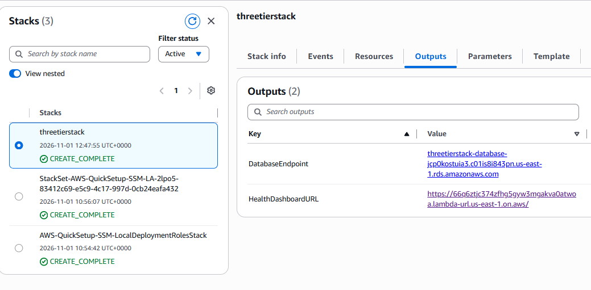
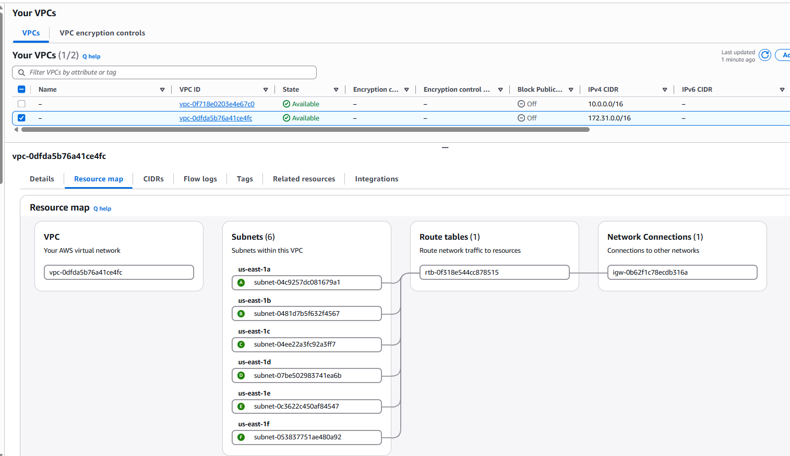
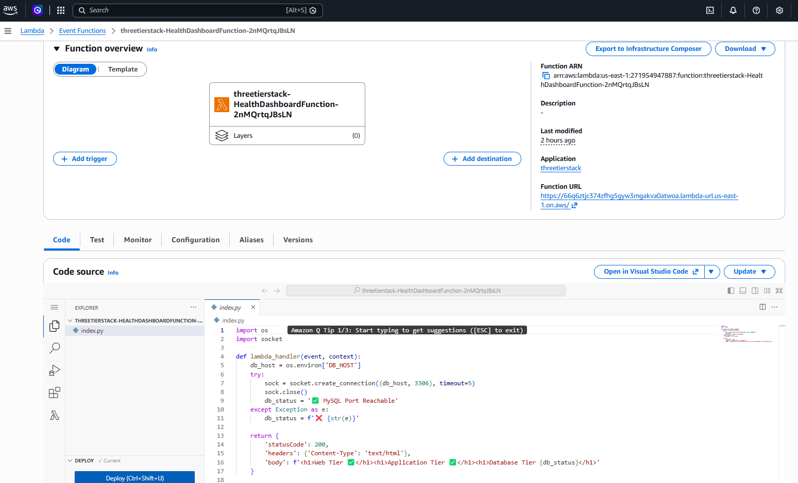
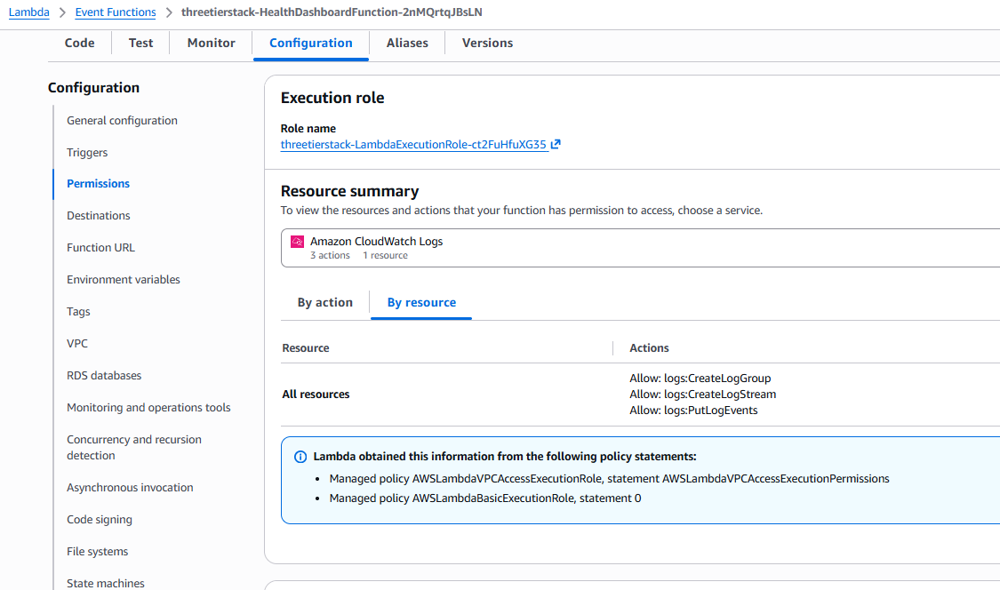
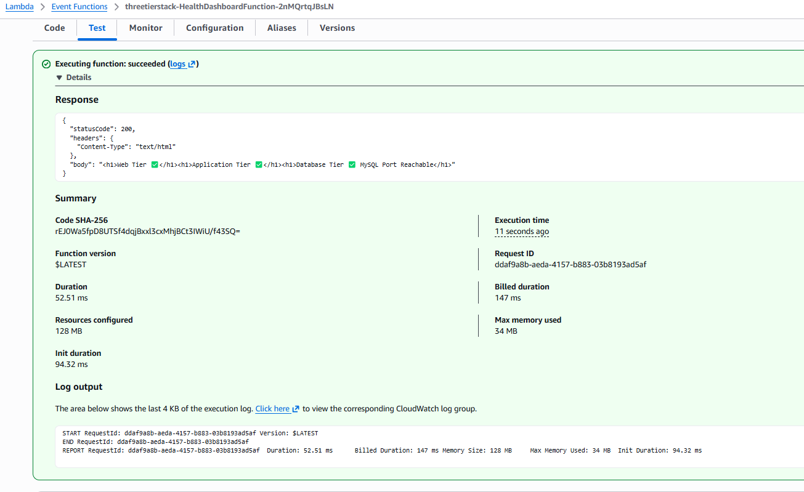
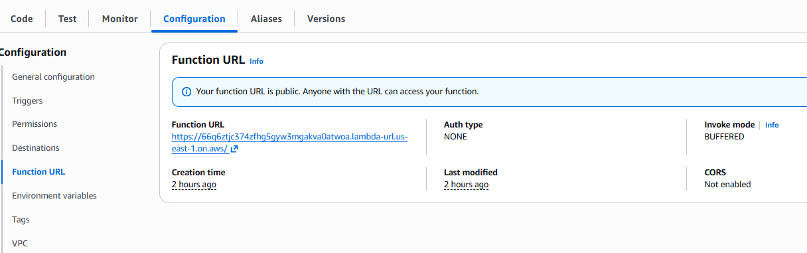
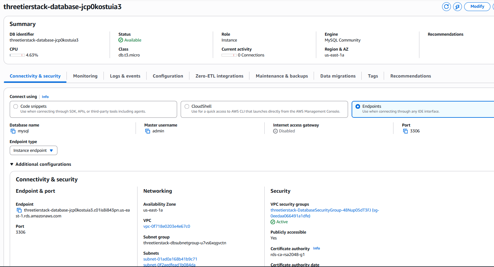

# CloudFormation Assignment
  Student Number: L00213592
  DevOps- 2026-2027 Lab Assignment 1

## Overview
This project demonstrates Infrastructure as Code (IaC) using AWS CloudFormation to automate the deployment of a static website and a three-tier cloud architecture.

## Project Objectives
  * Deploy a static website using Amazon S3.
  * Deploy a three-tier architecture with web, application and database tiers.
  * Apply automation, security, scalability and DevOps best practices.

## Key Technologies
  * AWS CloudFormation
  * Amazon S3
  * Amazon EC2
  * Amazon RDS
  * VPC and Security Groups
  * Git and GitHub

## Static Website Deployment
  * Host a website on S3.
  * Display the student's name and student number.
  * Configure bucket policies and website hosting settings.

## Three-Tier Architecture
  * Web Tier handles user requests.
  * Application Tier processes business logic.
  * Database Tier stores application data using RDS.

## Best Practices
  * Use reusable templates, parameters and outputs.
  * Implement least-privilege security.
  * Design for scalability and maintainability.
  * Use version control through GitHub.

## Testing
  * Validate CloudFormation stacks.
  * Verify website accessibility.
  * Confirm connectivity between tiers.

## Learning Outcomes
  * Understand Infrastructure as Code.
  * Gain AWS deployment experience.
  * Apply DevOps workflows and automation principles.

## Repository Structure
    D:.                                                            
    |   CODE_OF_CONDUCT.md                                         
    |   LICENSE                                                    
    |   README.md                                                  
    |   test                                                       
    |                                                              
    +---3-Tier                                                     
    |   |   3tier-Template.yaml              part -B - Template file for 3-Tier architecture                                                
    |   +---3Tier-Test2-Results              Template used in the initial stage and test results                  
    |   |                                           
    |   \---images                           Results from the part - B final template          
    |                                                              
    +---S3 Bucket                                                  
    |   \---Static website                   Part A - Files for the Static Website                      
    |       |   index.html                                         
    |       |   template.yaml                                      
    |       |                                                      
    |       +---Archive                      Folder with the test template file and results                      
    |       |       test.yaml                                      
    |       |                                                      
    |       \---images                       Results for the part -A                            
    |                                                              
    \---Website                              Index file for the website                      
            index.html                                             

# Static S3 Website

## Tutorials used to learn the basics to run a static website using S3 bucket

I used a few basic online learning materials to understand each step of adding a static website using a YAML template. Using samples from the AWS documentation page, I slowly developed the template file step by step. Before writing the template file, I followed the AWS CloudFormation lab and tried launching a static website manually to learn exactly what we needed to produce the output. That helped me write the template file step by step using samples from the AWS S3 documentation page. 

After installing the AWS CLI on my machine, I created the static website stack successfully by deploying the script added in the deployment section below, but I still had to manually upload the index file before testing the URL. 

## Deployment
Commands used are as follows

* Create Stack : aws cloudformation create-stack --stack-name s3-stack --template-body file:/Newtemplate.yaml
* Description of the stack: aws cloudformation describe-stacks --stack-name s3-stack

#### Basic projects:
 * https://asafmaoz.com/projects/staticwebsite.html 
 * https://medium.com/@elnala24/project-s3-static-website-with-cloudformation-2253652b7405
 * https://github.com/zirkelc/cloudformation-s3-static-website-https

 #### S3 Cloudformation help:
 * https://docs.aws.amazon.com/AWSCloudFormation/latest/TemplateReference/aws-resource-s3-bucket.html
 * https://docs.aws.amazon.com/AmazonS3/latest/developerguide/s3_example_s3_CreateBucket_section.html

 #### AWS CLI docs:
 * https://docs.aws.amazon.com/cli/latest/userguide/getting-started-quickstart.html
 * https://docs.aws.amazon.com/cli/latest/userguide/cli-configure-files.html
 * https://docs.aws.amazon.com/cli/v1/userguide/cli_cloudformation_code_examples.html#actions

 ## Results: 

# 3-Tier Architecture:

## Tutorials used to learn the basics to run a static website using S3 bucket

While searching for a 3-tier architecture in AWS CloudFormation, I found some good documents, and I followed the step-by-step instructions on a Medium page written by Aalok Trivedi. 

### Web server and Application server: 

Based on the example and AWS documentation, I started to create a VPC, Internet Gateway, and two public subnets using the CIDR 10.0.1.0/24 and 10.0.2.0/24. Using AWS CloudFormation Lab 5, I reached this step and ran a test to create a stack. I started creating two separate EC2 instances for the web server and the application server and got a success message for the web server. At this step, I got an error saying the public subnets weren't available in the zone. So I added the availability zone to the public and private subnets using the selection option and got a success message.  The testing template is kept under the 3Tier-Test3-Results folder for reference. 

### Database :

After that, I added the private database subnets, load balancer and security groups. In the first test, I got a success message from the web tier, but the database tier had an issue because I had problems connecting to the MySQL database on my laptop. So I couldn’t connect to the database endpoint from my laptop. Even after enabling public access to the endpoint, I still had trouble connecting to the database. The YAML file was located at 3Tier-Test2-Results/three-tier-templte-test1.yaml. 

So I started using the Lambda function with the help of the documentation and decided to add a function to check the database connection. I added a Lambda execution role to manage writing logs and create a network interface in the VPC. The ‘functionHealthDashboardFunction’ runs Python code to create a network connection to the MySQL database. If it has a success in connecting to the database, it displays a message with the DB status. If any one of these- wrong security group, wrong subnet, database unavailability, DNS issue, or timeout- then the Python code block will throw an error. 
Although the Lambda function verifies connectivity, I manually created an EC2 instance to verify web-tier connectivity and received a success message. 

### Analysis based on security and performance:

Since the RDS database is deployed in the private database subnet and is not publicly accessible, the internet users cannot access it. So it reduces the risk of unauthorised access. 

Since the Lambda function URL is publicly accessible by public, it leads to unauthorised usage and increases the cost as well. This example is suitable for small workloads and sample projects with limited CPU and memory. This project has fast performance and minimal database load and CPU usage. Since this example has no EC2 servers or load balancers, it costs very little. For a real-world application, you can improve security by using AWS Secrets Manager, enabling database encryption, and securing the Lambda function URL. 

#### Tutorials followed: 
* https://aws.amazon.com/blogs/architecture/building-a-three-tier-architecture-on-a-budget/
* https://medium.com/@aaloktrivedi/building-a-3-tier-web-application-architecture-with-aws-eb5981613e30
* https://aws.plainenglish.io/easy-guide-to-designing-a-3-tier-architecture-60d67c19d30a

## Use of LLM and tutorials
For this project, I used ChatGPT to create the index.html file with the basic data to display student name and number. I searched for a few examples to test the database connectivity using pythod code in Lamda function and implemented that in my template. I also prepared the structure for readme file with the help of ChatGPT.
By using the Static website template, I used the prompt, "prepare a 3-Tier architecture and use the html file to show the connectivity results from each tier". From the downloaded sample template, I used few more prompts to find the methods to check the database connectivity but failed to verify it as the MySQL from my laptop has connectivity issues. So once again I searced for Lambda functions to upgrade the template to show the results. 

## Results:

  * 
